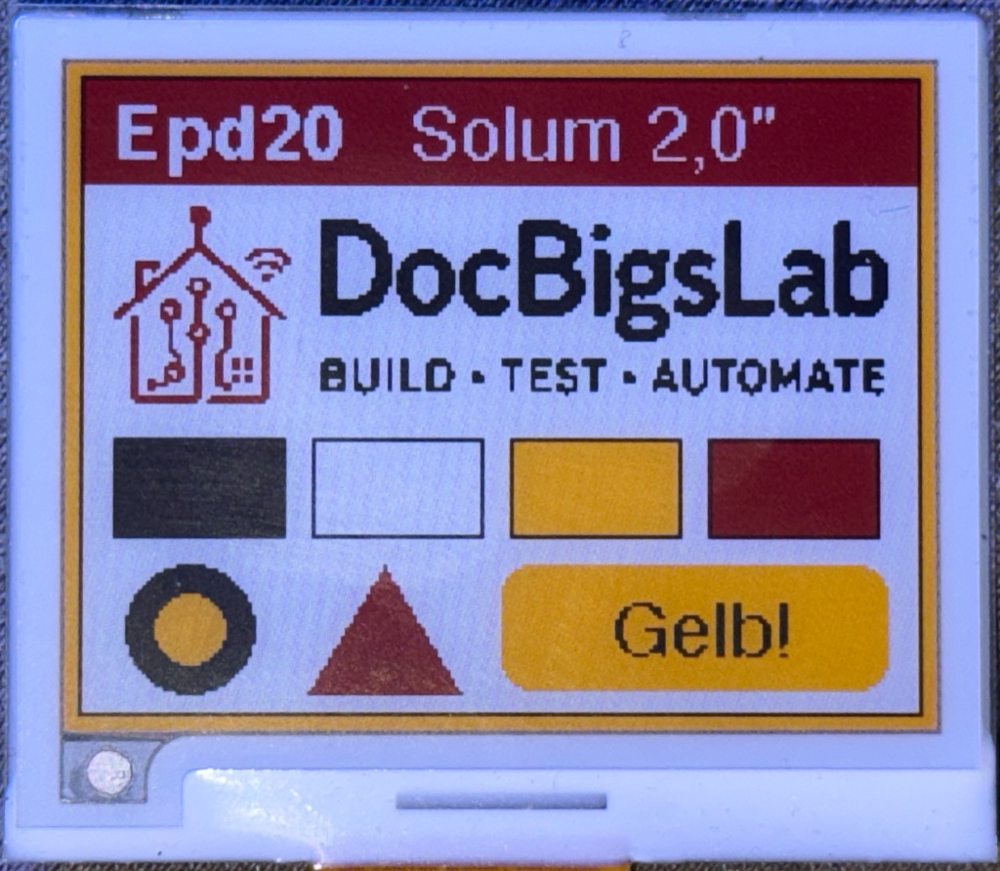

<p align="center">
  <a href="https://docbigs-lab.de">
    
  </a>
</p>
<p align="center">
  <a href="https://docbigs-lab.de">https://docbigs-lab.de</a>
</p>


# solum-epaper

Bibliothek `SolumEpaper` für E-Paper-Panels aus Solum-Preisschildern, für ESP32 und Adafruit GFX. Erstes Panel: 2,0" in Schwarz/Weiß/Gelb/Rot.

*Library for e-paper panels from SOLUM shelf labels on ESP32, based on Adafruit GFX. First panel: 2.0" black/white/yellow/red (EL020L8C4C, FPC-8161, 200x152). Documentation is in German.*



## Welches Panel habe ich?

| | 2,0" BWRY |
|---|---|
| Schild | Solum `EL020L8C4C` |
| Aufdruck Flexkabel | `FPC-8161` |
| Farben | Schwarz, Weiß, Gelb, Rot |
| Auflösung | 200 × 152 |
| Antwort auf `0x70` | `48 01 01` |
| Klasse | `Epd20` |
| Refresh | ca. 22 s |
| Details | [doc/panel-2.0-zoll.md](doc/panel-2.0-zoll.md) |

Das Panel versteht nicht den üblichen UC8151-Ablauf. Es braucht drei herstellerspezifische Befehle und erwartet das Bild mit 2 Bit pro Pixel. Mit GxEPD2 und ähnlichen Bibliotheken läuft es deshalb nicht.

Bei einem unbekannten Panel hilft die [Diagnosefirmware](extras/diagnose/). Sie liegt für beide Boards auch fertig als `.bin` bei und lässt sich ohne Entwicklungsumgebung im Browser flashen, siehe [doc/diagnose.md](doc/diagnose.md).

## Boards

| | Waveshare e-Paper ESP32 Driver Board | Seengreat ESP32-C6 E-Paper Driver Board |
|---|---|---|
| Schalter | 1 = **B**, 2 = **ON** | S1 = **ON**, S2 = **ON** |
| Pins im Code | `EpdPins` (Standard) | `epdPinsSeengreatC6()` |
| PlatformIO-Umgebung | `esp32dev` | `esp32c6` |
| mit dem 2,0" getestet | noch nicht | ✓ Diagnose |

Pins, Schalter und Flexkabel-Belegung: [doc/boards.md](doc/boards.md).

## Einbinden (PlatformIO)

```ini
lib_deps =
    https://github.com/DocBigs-Lab/solum-epaper
```

```cpp
#include <Epd20.h>

Epd20 epd;                          // Waveshare; Seengreat: Epd20 epd(epdPinsSeengreatC6());

void setup() {
    epd.begin();
    epd.fillScreen(EPD_WHITE);
    epd.fillRect(0, 0, 200, 26, EPD_RED);
    epd.fillCircle(100, 90, 30, EPD_YELLOW);
    epd.setTextColor(EPD_BLACK);
    epd.setCursor(10, 140);
    epd.print("Hallo");
    epd.display();                  // ca. 22 s
}
```

Farben: `EPD_WHITE`, `EPD_BLACK`, `EPD_RED`, `EPD_YELLOW`. Alles von Adafruit GFX funktioniert, auch `setRotation()`. `readChipId()` liefert die Antwort auf `0x70`, `lastRefreshMs()` die Dauer des letzten Refresh.

## Demo

[examples/Demo20](examples/Demo20/) zeichnet Kopfzeile, DocBigsLab-Logo, Farbfelder und Formen (Foto oben). Über den seriellen Monitor: `d` zeichnet neu, `c` reinigt das Panel (2 Runden schwarz, rot, gelb, weiß).

```sh
cd examples/Demo20
pio run -e esp32c6 -t upload -t monitor
```

## Inhalt

| Ordner | Inhalt |
|---|---|
| [src/](src/) | Bibliothek: `SolumCommon.h` (Farben, Pins), `Epd20` |
| [examples/Demo20/](examples/Demo20/) | Demo 2,0" |
| [extras/diagnose/](extras/diagnose/) | Diagnosefirmware: Panel erkennen, Testbilder, Reinigen; fertige `.bin` in `bin/` |
| [doc/](doc/) | Panel, Boards, Diagnose-Anleitung |

## Verwandt

- [ses-imagotag-bwr-epaper](https://github.com/DocBigs-Lab/ses-imagotag-bwr-epaper): Bibliothek `SesEpaper` für die Panels aus SES-imagotag-Preisschildern (7,4", 5,65", 4,2"), gleiche Boards

## Lizenz

MIT, siehe [LICENSE](LICENSE). Die Befehlsfolge des 2,0"-Panels folgt dem Solum-Treiber in [OpenEPaperLink Tag_FW_nRF52811](https://github.com/OpenEPaperLink/Tag_FW_nRF52811) (`uc_variant_029.cpp`). Übernommen wurden nur Befehle und Werte, kein Code.
