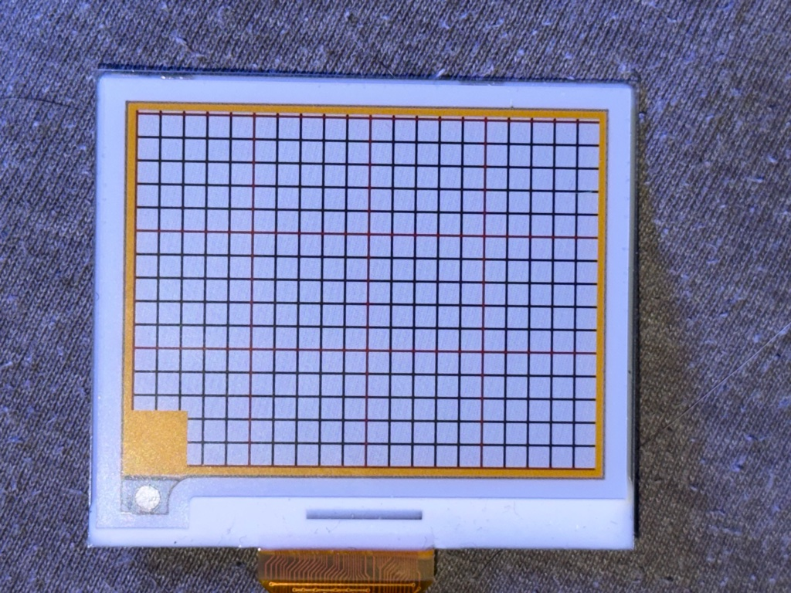

# 2,0" Schwarz/Weiß/Gelb/Rot aus Solum-Preisschildern

*Lineal aus der Diagnose: schwarze Linien alle 10 Pixel, rote alle 50, gelbes Quadrat am Anfang der Bilddaten (unten links).*

## Steckbrief

| | |
|---|---|
| Herkunft | Solum-Preisschild `EL020L8C4C` |
| Aufdrucke | Flexkabel `FPC-8161`, Etikett `10U22291-PW202` mit Datamatrix-Code |
| Farben | Schwarz, Weiß, Gelb, Rot |
| Auflösung | 200 × 152 Pixel, Querformat mit Flexkabel unten |
| Aktive Fläche | ca. 40 × 30 mm (ca. 127 dpi) |
| Flexkabel | 24 Pin, gleiche Belegung wie die Pervasive-Panels (siehe [boards.md](boards.md)) |
| Antwort auf `0x70` | `48 01 01`, Hersteller des Controllers unbekannt |
| Temperatur `0x40` | 1 Byte in Grad C (Zimmertemperatur: `1A` = 26 °C) |
| Status `0x71` | `03` im Ruhezustand (bereit, Hochspannung aus) |
| OTP `B9`, `72` | nur `FF` |
| Refresh | ca. 22 s bei Zimmertemperatur |

Ein Datenblatt gibt es nicht. Alles hier stammt aus Messungen mit der Diagnosefirmware und aus dem Solum-Treiber von OpenEPaperLink.

## Befehlsfolge

| Schritt | Befehl | Daten |
|---|---|---|
| Hardware-Reset, BUSY abwarten | | |
| herstellerspezifisch | `4D` | `55` |
| herstellerspezifisch | `F3` | `0A` |
| herstellerspezifisch | `31` | `00` |
| Booster | `06` | `E5 35 3C` |
| Rand/VCOM-Intervall | `50` | `57` |
| Panel-Einstellung | `00` | `07 09` plus ein Dummy-Byte `00` |
| Bilddaten | `10` | 7600 Byte, Format siehe unten |
| Power ON, BUSY abwarten | `04` | |
| Refresh, BUSY abwarten | `12` | |
| Power OFF | `02` | |

Eine Auflösung (`61`) wird nicht gesendet. `13` hat keine Wirkung.

Ohne die Befehle `4D`, `F3` und `31` läuft der Refresh zwar 22 s und das ganze Bild flackert, am Ende steht aber wieder das alte Bild da. Dasselbe passiert mit dem üblichen UC8151-Ablauf (Booster `17 17 17`, PSR `0F`, Auflösung über `61`).

Die Folge stammt aus `uc_variant_029.cpp` in [OpenEPaperLink Tag_FW_nRF52811](https://github.com/OpenEPaperLink/Tag_FW_nRF52811). Dort heißt sie „UC-Variante“ und gehört zum Solum-Controller-Typ `0x0D` (BWR-Schilder mit 2,6", 2,7" und 2,9"). Dass sie auch dieses Vierfarb-Panel ansteuert, ist ein Ergebnis unserer Tests.

## Bildformat

- 2 Bit pro Pixel, alles in `10`: `00` schwarz, `01` weiß, `10` gelb, `11` rot
- 4 Pixel pro Byte, das erste Pixel in Bit 7–6
- 152 Zeilen zu je 200 Pixeln (50 Byte), zusammen 7600 Byte
- die erste Zeile liegt **unten** am Flexkabel, das erste Pixel links

`Epd20` dreht die Zeilen beim Zeichnen um, sodass (0, 0) wie bei Adafruit GFX üblich oben links liegt.

## So wurde das Format ermittelt

Mit Taste `J` der damaligen Diagnose und festen Füllmustern:

| Daten in `10` | Daten in `13` | Ergebnis |
|---|---|---|
| `00` | `00` | schwarz |
| `FF` | `00` | rot |
| `00` | `FF` | schwarz |
| `FF` | `FF` | rot |

Also wirkt nur `10`. Danach:

- Die ersten 3 Byte jeder 25-Byte-Gruppe auf `FF` ergaben zwei gerade senkrechte Streifen. Eine Panelzeile ist also 50 Byte lang.
- Das erste Viertel der Daten auf `FF` ergab ein rotes Band unten über ein Viertel der Höhe. Die Daten beginnen also unten.
- Mit 150 Zeilen blieb die oberste Zeile gestört, mit 152 nicht.
- Vier Balken mit `00`, `01`, `10`, `11` ergaben Schwarz, Weiß, Gelb und Rot.

## Getestet

| Board | Ergebnis |
|---|---|
| Seengreat ESP32-C6 E-Paper Driver Board (S1 = ON, S2 = ON) | ✓ Diagnose (Testbild, Lineal) |
| Seengreat, S2 = OFF (3 Ω) | kein Unterschied |
| Waveshare e-Paper ESP32 Driver Board | noch nicht getestet |

`Epd20` und die Demo bauen für beide Boards. Am Panel getestet sind sie noch nicht.

## Quellen

- [OpenEPaperLink Tag_FW_nRF52811](https://github.com/OpenEPaperLink/Tag_FW_nRF52811): Solum-M3-Firmware, `src/epd_driver/uc_variant_029.cpp` (Befehlsfolge) und `uc_variant_bwry.cpp` (Farbcodes 2 Bit pro Pixel)
- [OpenEPaperLink](https://github.com/OpenEPaperLink/OpenEPaperLink): Typliste der Solum-Schilder (`oepl-definitions.h`, `resources/tagtypes/`)
- [Hacking eInk Price Tags, Dmitry.GR](https://dmitry.gr/?r=05.Projects&proj=29.+eInk+Price+Tags): Reverse Engineering älterer Solum-Schilder
